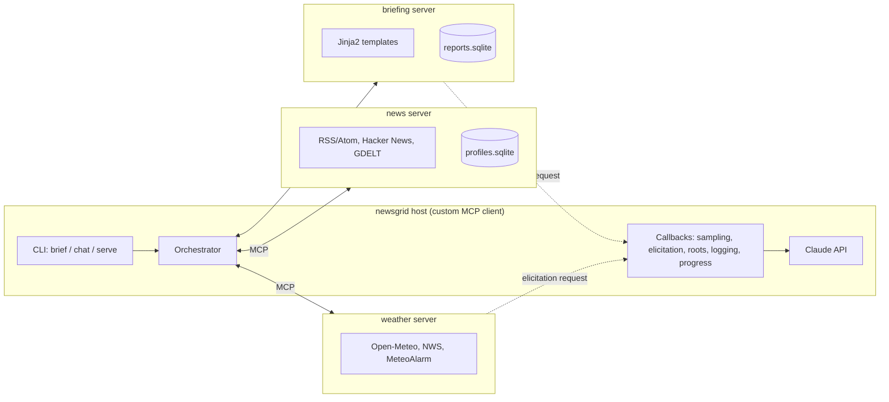
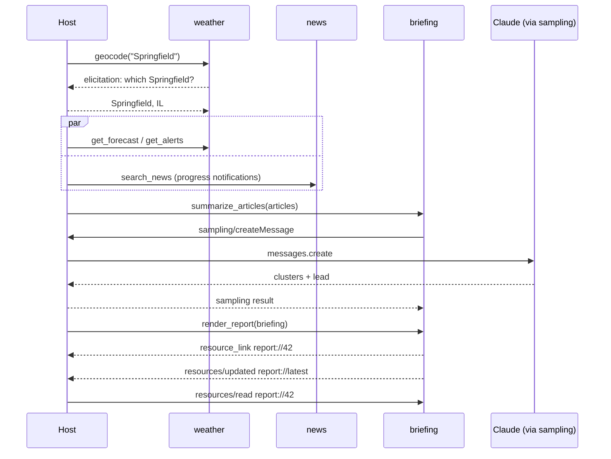

# newsgrid — Architecture

A location-centric briefing system built on the Model Context Protocol (MCP).
For a given city, newsgrid gathers local and topical news, the forecast and severe-weather
alerts, and produces an HTML briefing. Every MCP primitive in the project has a real job.

## 1. Goals

- Show a complete, current MCP implementation in Python: servers, a custom client/host,
  tools, resources, prompts, sampling, elicitation, roots, progress, logging, completions,
  subscriptions, and both transports (stdio and Streamable HTTP).
- Keep each server reusable on its own, so it also works in Claude Desktop, Claude Code
  or the MCP Inspector, not just in our client.
- Use data sources that need no API key and keep only headlines, snippets and links,
  never full article text.

## 2. System overview



Three focused servers plus one host. The host is the only part that talks to more than one
server, which is how real MCP hosts work. The servers never call each other.

### Diagram node IDs

The short names in the diagram source are Mermaid node IDs. The rendered diagram shows
the labels instead, but the IDs appear when reading the raw Markdown.

| ID | Meaning |
|---|---|
| `CLI` | Command-line interface (`brief` / `chat` / `serve`) |
| `ORCH` | Orchestrator, which routes calls to the servers |
| `CB` | Callbacks: the host's handlers for server-initiated requests (sampling, elicitation, roots, logging, progress) |
| `LLM` | Large language model, i.e. the Claude API |
| `W` | Weather server |
| `WP` | Weather providers (Open-Meteo, NWS, MeteoAlarm) |
| `N` | News server |
| `NP` | News providers (RSS/Atom, Hacker News, GDELT) |
| `NDB` | News database (`profiles.sqlite`, saved briefing profiles) |
| `B` | Briefing server |
| `TPL` | Templates (Jinja2) used to render the HTML report |
| `BDB` | Briefing database (`reports.sqlite`, rendered reports) |

In the sequence diagram in section 4, `H`, `W`, `N`, `B` and `C` stand for the host, the
weather, news and briefing servers, and Claude.

## 3. Components and MCP features

### 3.1 weather server (`newsgrid.servers.weather`)

| Primitive | Item | Notes |
|---|---|---|
| Tool | `geocode(location) -> list[Location]` | Open-Meteo geocoding |
| Tool | `get_forecast(location, days=3) -> Forecast` | structured output (`outputSchema`); `days` 1–16 |
| Tool | `get_alerts(location) -> list[Alert]` | NWS (US) / MeteoAlarm (EU), most severe first |
| Resource template | `weather://{location}/current` | JSON |
| Resource template | `weather://{location}/forecast` | JSON, 7 days |
| Completion | `location` argument | suggests place labels as the user types |
| Elicitation | ambiguous geocode | "Springfield" → asks the user which one |
| Annotations | all tools | `readOnlyHint=true`, `openWorldHint=true` |

**Location strings.** Every tool and resource takes the same `location` string: a place
name, optionally narrowed by region and/or country (`"Springfield, IL"`,
`"Springfield, Illinois, United States"`), or `"lat,lon"`. US state abbreviations are
understood. When some geocoder results have exactly the requested name, fuzzy matches are
dropped.

**Ambiguity and elicitation.** A query is ambiguous when several places match and the top
one is less than 10× as populous as the next ("Paris" → Paris, France without asking;
"Springfield" → ask). Tools resolve the location with SDK resolvers
(`Annotated[..., Resolve(fn)]`) that return `Elicit(...)` with an enum of up to six places.
The SDK sends this as an `InputRequiredResult` on protocol 2026-07-28 and as a mid-call
`elicitation/create` request on older versions. If the client cannot elicit, or the user
declines, `geocode` returns all candidates and the other tools use the best match.
Resources cannot ask, so they always use the best match.

**Alert matching.** NWS matches the point server-side. MeteoAlarm feeds have no geometry,
only area names in the national language ("Kreis und Stadt München"). The server therefore
looks the place up again in that language and matches whole words against each warning's
`areaDesc`, dropping expired warnings. Coordinates-only locations and countries outside
both sources return a tool error rather than an empty list.

### 3.2 news server (`newsgrid.servers.news`)

| Primitive | Item | Notes |
|---|---|---|
| Tool | `search_news(query, since, sources?) -> list[Article]` | fans out to providers concurrently |
| Tool | `top_headlines(source_id, limit)` | |
| Tool | `save_profile(name, topics, sources, location)` | write; `idempotentHint=true` |
| Tool | `delete_profile(name)` | write; `destructiveHint=true` |
| Resource | `news://sources` | catalog of configured feeds |
| Resource template | `news://profiles/{name}` | saved briefing profiles |
| Notification | `resources/list_changed` | sent when profiles change |
| Progress | `search_news` | one tick per feed fetched |
| Logging | feed failures and timeouts | sent to the client as log messages |
| Completion | `source_id`, `name` (profile) | |

### 3.3 briefing server (`newsgrid.servers.briefing`)

| Primitive | Item | Notes |
|---|---|---|
| Tool | `render_report(briefing: BriefingInput) -> ReportRef` | returns a `resource_link` to the report |
| Tool | `summarize_articles(articles) -> list[Cluster]` | uses **sampling**: clusters, de-duplicates and writes the lead |
| Tool | `export_report(report_id, filename)` | writes HTML into a client-granted **root** |
| Resource | `report://latest` | `text/html`; supports **subscriptions** |
| Resource template | `report://{id}` | `text/html` |
| Prompt | `daily_briefing(city, topics, tone)` | tells an agent how to gather data and build a briefing |
| Prompt | `severe_weather_digest(region)` | alert-first variant |

`summarize_articles` uses sampling so the server never holds an LLM API key. The host decides
which model answers and can show the request to the user.

### 3.4 Host / client (`newsgrid.client`)

- **Connection manager:** reads `newsgrid.toml`, which uses the same `mcpServers` layout as
  Claude Desktop, and opens one `ClientSession` per server over stdio or Streamable HTTP
  inside an `AsyncExitStack`.
- **Capability discovery:** lists tools, resources and prompts from every server and
  prefixes their names (`weather.get_forecast`) to avoid collisions.
- **Callbacks:**
  - sampling → Anthropic SDK (model configurable; defaults to `claude-sonnet-5-5`)
  - elicitation → interactive terminal form (`rich`)
  - roots → advertises `./reports` only
  - logging and progress → `rich` live display
- **Two run modes:**
  - `newsgrid brief --city Berlin --topics climate,tech`: a fixed pipeline that calls tools
    directly, the same way every time. Used for tests and scheduled runs.
  - `newsgrid chat`: agent mode. Claude gets every server's tools and can use the
    `daily_briefing` prompt, then decides which calls to make.
- **Subscriptions:** `newsgrid watch` subscribes to `report://latest` and reopens the browser
  whenever the report is updated.

## 4. Data flow (fixed `brief` pipeline)



## 5. Shared domain model (`newsgrid.core.models`)

Pydantic v2 models, shared by all servers and used for tool `outputSchema`s:

- `Location(id, name, country, country_code, admin1, admin2, lat, lon, timezone, population)`
- `Forecast(location, current: CurrentConditions, daily: list[DailyForecast])`
- `Alert(id, source, severity, event, headline, description, instruction, onset, expires, area)`
- `Article(id, title, url, source_id, published_at, snippet, topics)`
- `Cluster(title, summary, article_ids, priority)`
- `BriefingInput(location, forecast, alerts, clusters, generated_at)`
- `ReportRef(id, uri, created_at)`

Ranking rule: if a severe or extreme alert is active, matching weather stories go to the top
and the report opens with an alert banner. This is where the news and weather data meet.

## 6. Project layout

```
newsgrid/
├── pyproject.toml              # uv project; script entry points below
├── newsgrid.toml               # host config (mcpServers + settings)
├── ARCHITECTURE.md
├── src/newsgrid/
│   ├── core/
│   │   ├── models.py           # shared pydantic models
│   │   ├── http.py             # shared httpx.AsyncClient, retries, TTL cache
│   │   └── settings.py         # pydantic-settings
│   ├── servers/
│   │   ├── weather/
│   │   │   ├── server.py       # MCPServer app: tools/resources/completions
│   │   │   ├── service.py      # location parsing, ambiguity, alert routing
│   │   │   └── providers/      # open_meteo.py, nws.py, meteoalarm.py
│   │   ├── news/
│   │   │   ├── server.py
│   │   │   ├── store.py        # aiosqlite profiles
│   │   │   ├── feeds.toml      # source catalog
│   │   │   └── providers/      # rss.py, hackernews.py, gdelt.py
│   │   └── briefing/
│   │       ├── server.py
│   │       ├── ranking.py
│   │       ├── store.py        # aiosqlite reports
│   │       └── templates/      # briefing.html.j2, partials/
│   └── client/
│       ├── cli.py              # typer: brief / chat / watch / serve
│       ├── connections.py      # multi-server session manager
│       ├── callbacks.py        # sampling, elicitation, roots, logging, progress
│       ├── pipeline.py         # fixed brief pipeline
│       └── agent.py            # Claude tool-use loop over MCP tools
└── tests/
    ├── conftest.py             # in-memory client<->server fixtures
    ├── fixtures/               # recorded HTTP responses
    ├── servers/                # one module per server
    └── client/
```

Entry points: `newsgrid` (host CLI), `newsgrid-weather`, `newsgrid-news` and
`newsgrid-briefing` (each server runs on its own; `--transport stdio|http`).

## 7. Technology choices

| Concern | Choice | Why |
|---|---|---|
| MCP | official `mcp` Python SDK v2 (`MCPServer`, formerly FastMCP, + `Client`) | reference implementation, follows the spec closely |
| HTTP | `httpx` (async) + `stamina` for retries | |
| Models / config | `pydantic` v2, `pydantic-settings` | also generates tool schemas |
| Storage | `aiosqlite` | profiles and reports; no server to run |
| Feeds | `feedparser` | RSS/Atom |
| HTML | `jinja2`, one self-contained template with inline CSS | report opens anywhere |
| CLI / UI | `typer`, `rich` | |
| LLM | `anthropic` SDK | sampling callback and agent mode |
| Tooling | `uv`, `ruff`, `pyright`, `pytest` + `anyio`, `respx` | |

## 8. Testing strategy

- **Unit:** providers against recorded fixtures (`respx`); ranking; template rendering.
- **Protocol:** in-memory client↔server sessions using the SDK's memory transport. These
  check tool schemas, resource reads, completions, list_changed and subscription
  notifications, and use fake sampling and elicitation callbacks.
- **End-to-end:** the `brief` pipeline over real stdio subprocesses with recorded HTTP.
- **Manual:** MCP Inspector against each server; add the servers to Claude Code / Desktop.

## 9. Milestones

1. **Skeleton:** uv project, core models, shared HTTP client, test fixtures.
2. **weather server:** tools, resources, completions, elicitation; Inspector check.
3. **news server:** providers, progress, logging, profiles + list_changed.
4. **briefing server:** ranking, template, `report://` resources, subscriptions, prompts.
5. **Host:** connection manager, callbacks, `brief` pipeline. First full HTML report.
6. **Sampling and agent mode:** `summarize_articles`, `chat`.
7. **Streamable HTTP:** `serve` mode, Docker Compose for the three servers.
8. **Stretch goals:** OAuth on the HTTP transport, async tasks for long fetches,
   scheduled briefings.

## 10. Risks

- **Feed reliability:** feeds change or disappear. Each provider fails on its own, the
  failure is logged to the client, and the report notes which sources were missing.
- **Copyright / terms of service:** store and show only titles, snippets and links.
- **Spec changes:** pin the `mcp` SDK version and check its changelog at each milestone.
- **Sampling support varies by host:** `summarize_articles` falls back to a deterministic,
  non-LLM clustering when the client does not support sampling.
